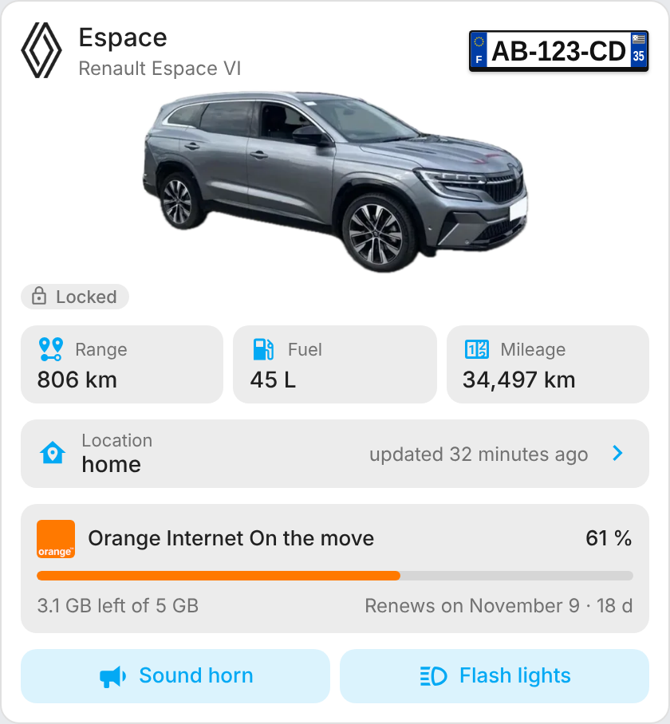
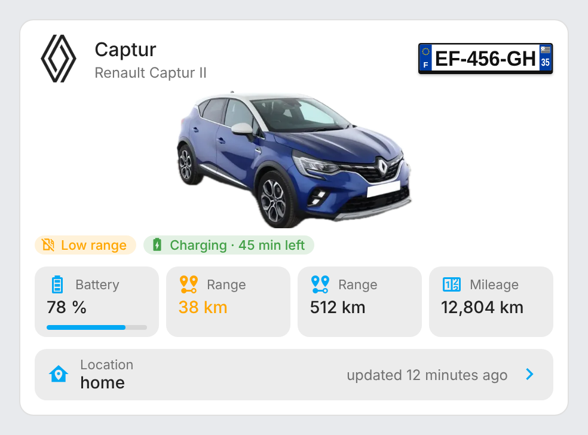
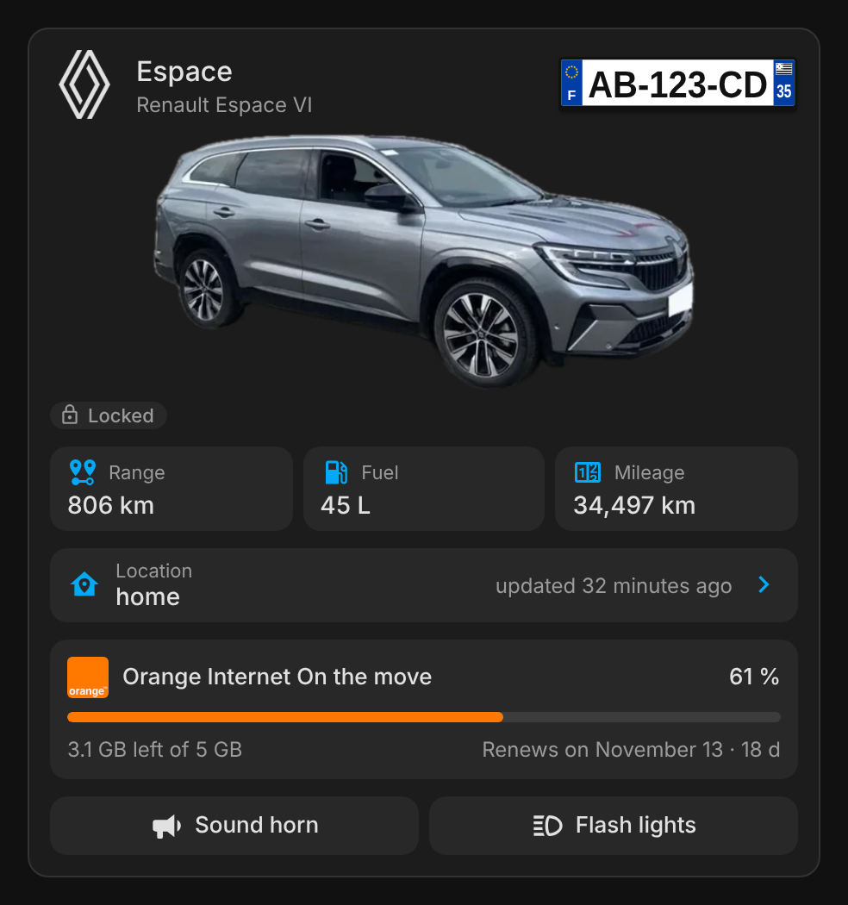
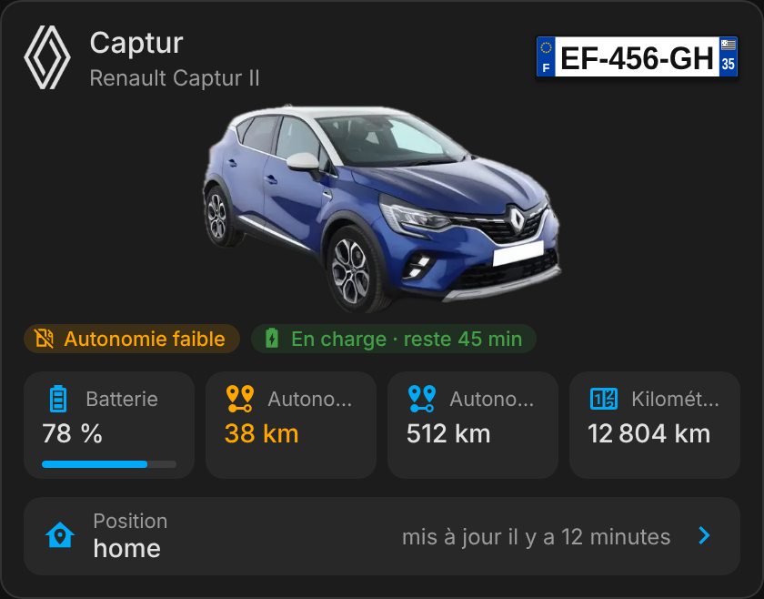

# ha-renault-card

[](https://github.com/hacs/integration)
[](https://github.com/juju35/ha-renault-card/actions/workflows/hacs.yml)
[](https://github.com/juju35/ha-renault-card/actions/workflows/validate.yml)
[](https://github.com/juju35/ha-renault-card/releases/latest)
[](LICENSE)

Custom Lovelace cards for Home Assistant's [Renault](https://www.home-assistant.io/integrations/renault/) integration: a **vehicle card**, with an optional section for the [Orange Internet On the move](https://github.com/rexave/hass-orange-internet-on-the-move) data plan of the car, and a **map card** showing your vehicles.

Pick the vehicle, the card finds all its entities by itself.

[](https://my.home-assistant.io/redirect/hacs_repository/?owner=juju35&repository=ha-renault-card&category=plugin)

| Espace (with Orange Internet On the move) | Captur |
|---|---|
|  |  |

## Features

- Range, fuel level, battery level, mileage, outside temperature and tyre pressure: whatever your car exposes
- Fuel gauge when you set the tank capacity, and a low range warning
- Charging status and time left, plug, lock, door and air conditioning status
- Location with the time of the last update; tap it to open the map
- Action buttons for every button of the vehicle (horn, flash lights, air conditioning, start/stop charge), pressed with a confirmation tap, and the charge mode picker for electric cars
- Renault logo next to the name, black on light themes and white on dark themes
- Built-in pictures for the Espace and the Captur, or your own picture, and a French licence plate drawn like the real one (EU band, department, Breton flag for Brittany)
- Optional **lease tracking** (LOA): mileage driven against the allowance, gap to the allowance today, kilometres per month left, end-of-lease projection (average or last 30 / 90 days) and estimated cost of the excess, always shown as a status; pace, contract year figures and a mileage chart folded by default
- Optional **Orange Internet On the move** section: data left, percentage, renewal or expiry date
- Automatic entity discovery from the device (English or French entity IDs)
- Visual editor in the dashboard UI (no YAML needed)
- English and French, follows the Home Assistant language
- Light and dark theme compatible
- HACS-ready, no CDN: the map libraries ship with the card

**Map card** (`custom:renault-map-card`)

- All your Renault vehicles on one map (or the ones you pick), each with its picture, name and range
- Popup with the picture, location, last update, range, fuel, battery and mileage, plus **Directions** (Google Maps) and **Details** buttons
- Home marker
- Base maps without API key: Home Assistant's own map (vector, light or dark), OpenStreetMap, OpenStreetMap France, IGN map and aerial photos, OpenTopoMap, CyclOSM, Esri satellite, or your own tile URL
- Follows the light / dark theme

## Prerequisites

- Home Assistant with the [Renault](https://www.home-assistant.io/integrations/renault/) integration set up
- Optional: the [Orange Internet On the move](https://github.com/rexave/hass-orange-internet-on-the-move) integration, for the data plan section

## Installation

### Via HACS (recommended)

Click the button below to add the repository directly:

[](https://my.home-assistant.io/redirect/hacs_repository/?owner=juju35&repository=ha-renault-card&category=plugin)

Or manually:

1. Open HACS → **Frontend** → **⋮** → **Custom repositories**
2. Add `https://github.com/juju35/ha-renault-card` — Category: **Dashboard** (Lovelace)
3. Search for **Renault Card** and install it (both cards come in the same package)
4. Clear your browser cache and refresh

HACS registers the dashboard resource for you.

### Manual

1. Download all the `.js` files from the [latest release](https://github.com/juju35/ha-renault-card/releases/latest): `renault-card.js` and the map libraries (`leaflet.js`, `leaflet-maplibre-gl.js`, `maplibre-gl.js`, `maplibre-gl-worker.js`, `maplibre-gl-css.js`)
2. Copy them all to the same folder, for example `/config/www/` (the map card loads the libraries from the folder `renault-card.js` comes from)
3. Go to **Settings → Dashboards → Resources** → Add resource:
   - URL: `/local/renault-card.js`
   - Type: **JavaScript Module**
4. Clear your browser cache and refresh

## Configuration

### Visual editor

Add the card from the dashboard (**Add card → Renault Card**). The first Renault vehicle is picked automatically; change it with the **Vehicle** field, then set the name, picture, tank capacity and the sections to show. The **Entities (advanced)** panel lets you force an entity if auto-detection picks the wrong one. Options left at their default are not written to the YAML.

### Vehicle picture

The card ships with pictures of the **Espace** and the **Captur**, picked from the vehicle model: nothing to set up for these two.

For another model, or to use your own photo, give the card any image, ideally a PNG or WebP with a transparent background. Put it in `/config/www/renault/` and use `/local/renault/<file>`:

```yaml
image: /local/renault/clio.png
```

Without a picture (no built-in one for the model and no `image`, or `show_image: false`), the card shows only the Renault logo next to the name (or a car icon with `show_logo: false`).

### Lease tracking (LOA)

Set the lease start date, its duration in months and the yearly mileage allowance: the card adds a **Lease** section with the kilometres driven against the allowance, a marker for where you should be today, your yearly pace, the projected mileage at the end of the lease and a status:

- **green**: within the allowance, with the margin left at the end of the lease
- **orange**: at the current pace, you will go over the allowance (projected excess)
- **red**: the allowance is already exceeded

Below the bar (ticks mark the contract years): the kilometres above or below the allowance line today, and the kilometres per month left until the end of the lease. With `extra_km_cost`, the status adds the estimated cost of the excess.

The projection starts after 30 days. It uses the average since the start of the lease, or with `forecast: 90` (or `30`) the pace of the last 90 (or 30) days, which reacts faster to a change of habits.

Tap the section header to unfold the details: pace, end-of-lease projection, the current contract year (contract years run from the start date) with its allowance and year-end projection, and the chart of actual mileage, allowance and projection. The history comes from the long-term statistics of the mileage sensor, kept by Home Assistant's recorder; it is fetched once an hour. The details are folded by default.

```yaml
lease:
  start_date: "2024-12-01"
  duration: 37        # months
  km_per_year: 20000
  start_mileage: 12   # optional, odometer at delivery
  forecast: 90        # optional: 90 or 30 days, average since the start by default
  extra_km_cost: 0.08 # optional, per km, shows the cost of the excess
```

Also in the visual editor, in the **Lease tracking** panel. Without `lease`, the section is not shown.

| Lease (folded chart open) | Dark, French |
|---|---|
|  |  |

### Minimal

```yaml
type: custom:renault-card
device_id: 5a8c1932ddf3f29163a275f06789b1bf
```

Use either `device_id` (what the visual editor writes) or `entity` (any entity of the vehicle). With neither, the card uses the first Renault vehicle it finds.

### Full options

```yaml
type: custom:renault-card
device_id: 5a8c1932ddf3f29163a275f06789b1bf
name: Espace
fuel_tank_capacity: 55
low_range: 100
show_plate: true
plate_department: "35"
show_location: true
show_actions: true
show_data_plan: true
data_plan_device_id: 63dc3dbab368191d3a6944a848e2c8ce
lease:
  start_date: "2024-12-01"
  duration: 37
  km_per_year: 20000
  start_mileage: 12
language: en
entities:
  mileage: sensor.espace_mileage
  location: device_tracker.espace_location
```

### Options reference

| Option | Required | Default | Description |
|---|---|---|---|
| `device_id` | ❌* | Auto | Renault vehicle device (*or `entity`; the first vehicle is used if both are missing) |
| `entity` | ❌ | — | Any entity of the vehicle, used to find the device |
| `name` | ❌ | Device name | Card title |
| `image` | ❌ | Built-in | Picture URL; replaces the built-in Espace / Captur picture |
| `show_logo` | ❌ | `true` | Show the Renault logo next to the name (follows the theme text colour) |
| `show_image` | ❌ | `true` | Show the vehicle picture |
| `fuel_tank_capacity` | ❌ | — | Tank capacity in litres; shows the fuel gauge |
| `low_range` | ❌ | `100` | Range (km) below which the card shows a low range warning; `0` turns it off |
| `show_plate` | ❌ | `true` | Show the licence plate (when the device name is a French plate) |
| `plate_department` | ❌ | — | Department number on the right of the plate, e.g. `35`; the Breton flag is added for 22, 29, 35 and 56 |
| `show_location` | ❌ | `true` | Show the location row |
| `show_actions` | ❌ | `true` | Show the action buttons and charge mode |
| `show_data_plan` | ❌ | `true` | Show the Orange Internet On the move section when a data plan is found |
| `data_plan_device_id` | ❌ | Auto | Orange Internet On the move device; found from the vehicle model when empty |
| `lease` | ❌ | — | Lease tracking: `start_date` (`YYYY-MM-DD`), `duration` (months) and `km_per_year` are required to show it; `start_mileage` (km at delivery) defaults to `0`; `forecast`: `90` or `30` to project from the last days (average since the start by default); `extra_km_cost`: cost per extra km |
| `language` | ❌ | Auto | Force language: `fr` or `en` (auto-detects from HA settings) |
| `entities` | ❌ | Auto | Override detected entities: `mileage`, `fuel_autonomy`, `fuel_quantity`, `battery_level`, `battery_autonomy`, `location` |

## Map card

Add it from the dashboard (**Add card → Renault Map Card**). With no vehicle selected it shows all the Renault vehicles that have a location.

```yaml
type: custom:renault-map-card
title: Vehicles
map_style: ha
height: 400
```

| Option | Required | Default | Description |
|---|---|---|---|
| `devices` | ❌ | All vehicles | List of Renault device IDs to show |
| `title` | ❌ | `Vehicles` | Card title; empty for none |
| `map_style` | ❌ | `ha` | `ha` (Home Assistant vector map), `osm`, `osm_fr`, `ign`, `ign_photo`, `topo`, `cyclosm`, `satellite` or `custom` |
| `theme` | ❌ | `auto` | Base map theme: `auto` (follows Home Assistant), `light` or `dark` |
| `tile_url` | ❌ | — | Tile URL with `{z}`, `{x}`, `{y}`, for `map_style: custom` |
| `tile_attribution` | ❌ | — | Attribution shown for custom tiles |
| `height` | ❌ | `400` | Map height in pixels |
| `zoom` | ❌ | Auto | Fixed zoom level; by default the map fits the vehicles and home |
| `show_icon` | ❌ | `true` | Renault logo in the header |
| `show_home` | ❌ | `true` | Home marker |
| `show_name` | ❌ | `true` | Vehicle name on the markers |
| `show_picture` | ❌ | `true` | Vehicle picture on the markers and in the popup |
| `show_fullscreen` | ❌ | `true` | Full screen button under the zoom buttons (on iPhone the card fills the screen) |

The `ha` base map is the one Home Assistant's own map card uses (Home Assistant 2026.9 or later, WebGL2): OpenStreetMap vector tiles through your instance, in light or dark. On older versions or without WebGL2, the card falls back to OpenStreetMap raster tiles, also through Home Assistant when it can. Leaflet and MapLibre GL ship with the card (see [licenses](licenses)): only the map tiles come from the network.

## Screenshots

| Espace (fuel, data plan) | Captur (plug-in hybrid, charging) |
|---|---|
|  |  |
|  |  |

Dark screenshots are in French.

## How it works

The card reads the entity registry to list the entities of the chosen device, then matches each one by its translation key, then by its entity ID (English and French slugs), then by its attributes. Everything else the device exposes as a `button` becomes an action button.

**Action buttons** need a second tap within 3 seconds, so a horn doesn't go off by accident.

**Orange Internet On the move**: the data plan device is named after the car (for example *Data Plan for RENAULT Espace*), so the card links it to the vehicle whose model matches. Set `data_plan_device_id` to pick one by hand. The integration reports data in megabytes (labelled Mbit); the card shows it in GB above 1 GB. The date is shown as a renewal date for recurring plans, as an expiry date otherwise. Click the Orange logo to open the [Orange Internet On the move customer area](https://internetonthemove.orange-business.com/renault/#/login); click anywhere else in the section for the entity details.

## Development

```bash
npm install
npm run build        # stamps the version of package.json into dist/renault-card.js
npm run check        # builds and checks the card (run in CI)
npm run screenshots  # renders the card with mock Renault vehicles into screenshots/
```

The map libraries in `vendor/` (Leaflet, MapLibre GL and its Leaflet adapter) are vendored as-is; the build copies them next to the card, which loads them on demand for the map card.

`dist/` is not committed: `npm run build` creates it locally, CI builds it on every push, and the release workflow attaches the built file to the release, which is where HACS downloads it from.

### Releasing

1. Bump `version` in `package.json`
2. Add a `## <version>` section at the top of [CHANGELOG.md](CHANGELOG.md)
3. Push to `main`: the **Release** workflow builds the card, creates the tag and the GitHub release with the changelog section as notes, and attaches the files of `dist/`

## Translations

The card auto-detects the language from your Home Assistant settings. Currently supported:

| Language | Code |
|---|---|
| English | `en` |
| Français | `fr` |

Contributions for additional languages are welcome!

## License

[MIT](LICENSE)
